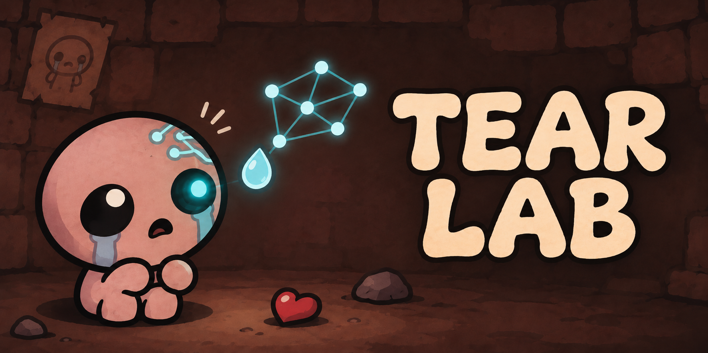

# TearLab



**Learning to fight, one tear at a time.**

[](https://github.com/maaaakks/tearlab/actions/workflows/cpu-checks.yml)

Experimental reinforcement learning for **The Binding of Isaac**, using an
empirically calibrated combat simulator, batched GPU physics and PPO. A Lua mod
can run a frozen policy against vanilla enemies in an owned copy of the game.

This is a research prototype: **two enemy archetypes, at most four enemies,
rectangular rooms**. It is not a complete Isaac simulator or an agent that plays
a full run. Simulator scores and qualitative in-game observations are reported
separately. No game executable, assets, decompiled code or saves
are distributed here. Only the latest trained checkpoint is included under
`models/latest.pt`, with its SHA256 and [model card](models/README.md).

## Origins and direction

TearLab is a substantially evolved research fork of
[Sepzie/Binding of AI](https://github.com/Sepzie/binding-of-ai), with the original
Git history and author credits preserved. It is a derivative project with its
own experimental direction, not an independent implementation from scratch.

The original project provided the Lua/Python TCP environment, state encoding
and a Stable-Baselines3 PPO curriculum. This version focuses on empirically
calibrated combat physics, batched CPU/CUDA simulation, a custom PyTorch PPO
loop, controlled curriculum comparisons and frozen-policy transfer to the game.
The public tree is curated from the local IsaacRL / Alpha Isaac experiments;
the historical names remain in technical interfaces and archived commits.

The long-term goal is to learn through interaction and retain useful skills
between runs. The current release demonstrates bounded combat research,
not autonomous mastery of a complete Isaac run.

## Current result

A controlled experiment compared 200 updates with a three-contact budget then
400 no-hit updates against 600 strict updates. Same parent, scenes, rewards and
19,660,800 new decisions per arm; two optimization seeds.

| Large room, four distant shooters; no-hit wins | Strict | Recovery → strict |
|---|---:|---:|
| Seed 1, final checkpoint | 4.3% | 24.3% |
| Seed 2, final checkpoint | 14.5% | 21.5% |

The selected candidate scored 23.4%, versus its parent's 3.9%, on fresh random
layouts of known factors. Retention averaged 89.1% versus 88.7%. Only one seed
passed the development retention guard. These are **simulator results**, not
measured win rates in Isaac or proof of generalization to unseen enemy families.

See [results](docs/FOCUS_RECOVERY_RESULTS.md) and
[protocol](docs/FOCUS_RECOVERY_PROTOCOL.md). The earlier roughly 42× headline
concerned simulation; it must not be presented as end-to-end training speed.

## Install and run CPU checks

Python 3.11 or newer; use a virtual environment. Install PyTorch for your
platform first, then the other requirements:

```powershell
py -3.11 -m venv .venv
.\.venv\Scripts\python.exe -m pip install -r requirements.txt
.\.venv\Scripts\python.exe -B -m unittest research.test_terminal_physics_review research.test_mastery research.test_focus_recovery -v
```

The default suite uses CPU reference physics and skips GPU tests. No game,
checkpoint, CUDA toolkit or paid service is needed for those tests. Installation,
the CPU suite and training CLI help also pass in a fresh GitHub Actions Linux
environment with Python 3.11. GPU builds in a fresh environment remain unverified.
[Environment details](docs/REPRODUCIBILITY.md).

## GPU training

Requires CUDA-enabled PyTorch, NVIDIA CUDA Toolkit (`nvcc`), and a compatible
GPU. Native CPU compilation on Windows also requires an MSVC developer shell.
The native builder defaults to architecture 89 (the tested RTX 4070).

```powershell
.\.venv\Scripts\python.exe -B research/focus_recovery.py --parent models/latest.pt --output artifacts/focus-run
```

A compatible checkpoint contains `state_dict` for `CrossPolicy('pool')`.
Published scores came from a trained lineage; random weights cannot reproduce
them with the continuation budget above. Only the latest checkpoint is bundled;
ancestor weights used for the historical comparisons are not included. W&B runs
offline; training never requires logging into a cloud account. No training is
launched by importing the modules or running the default CPU tests.

## Live preview

See [live preview setup](docs/LIVE_PREVIEW.md). It is opt-in and requires an
owned copy of Isaac Repentance and compatible LuaSocket support. Nothing installs
itself, edits saves or enables the debug console automatically.

## Layout

| Path | Purpose |
|---|---|
| `research/` | GPU simulator, PPO and curriculum experiments |
| `python/` | Physics, policies and frozen-policy TCP bridge |
| `mod/` | Standalone optional live preview |
| `data/physics_v2/calibration_r5.json` | Small empirical physics configuration |
| `docs/` | Protocols, results and limitations |
| `artifacts/` | Ignored local outputs and native build cache |

## Public snapshot

This first public snapshot is based on the prepared
`research/gpu-curriculum-public` branch. Historical experiments and raw logs stay
in the research checkout; `PUBLIC_SNAPSHOT.json` records source hashes and
revision. The bundled latest checkpoint comes from the subsequent consolidation
experiment described in its [model card](models/README.md).

Project-owned code, documentation and bundled weights use **CC0-1.0**, a public
domain dedication: reuse, modification and commercial redistribution are allowed
without an attribution requirement. Third-party components retain their own
terms. See [license](LICENSE), [third-party notices](THIRD_PARTY_NOTICES.md) and the
[publication checklist](docs/PUBLICATION.md).
