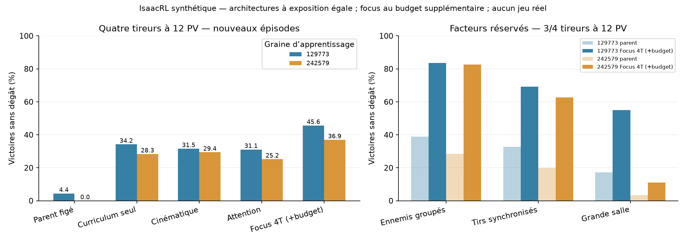
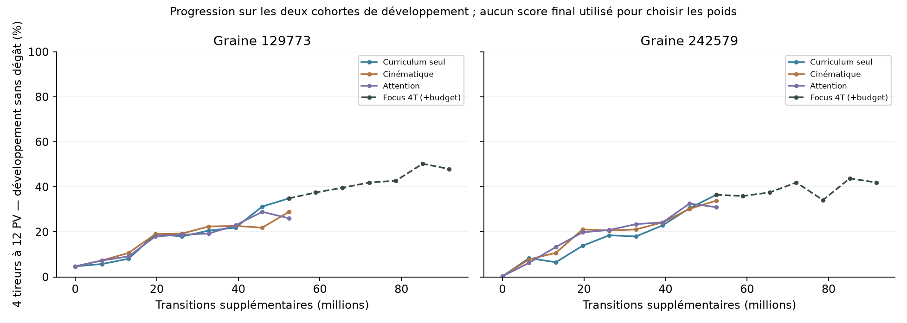

# IsaacRL — tirs croisés et représentations, 9 novembre 2026

Les trois étapes autorisées sont exécutées dans le simulateur. Aucun jeu réel, collecte live ou modification du mod.

## Diagnostic préalable

128 épisodes/cellule, poids parents figés, séparation des placements historiques et contrôlés. Sur quatre tireurs à 12 PV, les parents réussissent 4,7 % / 0,4 % dans le générateur contrôlé. Les projectiles causent 83,2 % / 89,1 % des épisodes ; les contacts 11,1 % / 10,4 %, les timeouts 1,0 % / 0,2 %. Le blocage principal est donc la survie.

Les deux parents ont des stratégies différentes : 40 % / 83 % du temps près des murs dans ces cas. Le diagnostic rapporte les morts près des murs ET cette exposition ; il ne démontre pas qu’un mur cause la mort. Les 20 dernières décisions diagnostiques de tous les épisodes sont conservées dans baseline-diagnostic/*.npz.

Le reset historique avait un cas spécial quatre tireurs. Le nouveau générateur produit quatre positions indépendamment du nombre actif, avec séparation >=35 et distance initiale joueur >=80. Un secours sur grille garantit la validité quand le rejet échoue : audit CPU de 2048 épisodes/layout, 0 % au centre, 0,02 % des positions libres, 0,74 % au bord, 5,25 % dans les coins. Aucun secours observé pour les placements groupés. Les résultats « ring » incluent ce secours, ils ne représentent pas un anneau géométrique parfait.

## Comparaison des représentations à exposition égale

Même parent par graine, mêmes scènes/RNG/réglages PPO, Adam neuf pour tous, reward sparse inchangée, fin au premier dégât, horizon fini 400. Curriculum : 3T à 4 puis 12 PV, 4T à 4 puis 12 PV ; départs centre/libre/bord/coin et rétention des compétences anciennes. Chaque bras reçoit 1600 updates ×1024 voies ×32 décisions = **52 428 800 transitions supplémentaires**. Les checkpoints sont choisis uniquement sur deux cohortes de développement ; ils peuvent précéder la fin du budget.

Les branches supplémentaires sont nulles à l’initialisation : leurs politiques commencent avec exactement les mêmes sorties. Cinématique = rapprochement, temps et distance au plus proche passage à vitesse constante, dérivés des observations. Attention = pondération des projectiles à partir du contexte joueur/commande. Aucun oracle, teacher ou donnée future.

| Variante | Paramètres | 4T12 graine 129773 | 4T12 graine 242579 | Débit entraînement moyen |
|---|---:|---:|---:|---:|
| réseau actuel | 53,806 | 34.2 % | 28.3 % | 288,878 décisions/s |
| cinématique | 63,470 | 31.5 % | 29.4 % | 255,213 décisions/s |
| attention | 60,174 | 31.1 % | 25.2 % | 267,610 décisions/s |

Débit = collecte + PPO mesurés, hors capture, développement et audit. Même exposition ne signifie pas mêmes FLOPs ni mêmes pas Adam : le garde-fou KL peut interrompre une optimisation.

**Recette sélectionnée avant ouverture du test final : réseau actuel.** Critère : rétention minimale sur les deux graines, puis score cible moyen. Toutes les variantes sont conservées ; le test final ne sélectionne aucun poids.

Les colonnes « Nouveau » ci-dessous incluent la prolongation ciblée de 1200 updates, rapportée séparément plus bas ; le tableau de représentations conserve son budget égal.

## Nouveaux épisodes et facteurs réservés

Deux cohortes finales 970101/970201, 128 épisodes/cellule/cohorte, actions déterministes. Le cas quatre tireurs 12 PV compte 4 placements ×2 cohortes ×128 = **1024 épisodes par modèle**. Le tableau suivant porte sur trois/quatre tireurs à 12 PV ; les facteurs sont évalués séparément.

| Examen | Parent 129773 | Nouveau 129773 | Parent 242579 | Nouveau 242579 |
|---|---:|---:|---:|---:|
| Quatre tireurs 12 PV | 4.4 % | 45.6 % | 0.0 % | 36.9 % |
| Trois tireurs 12 PV | 33.1 % | 80.5 % | 24.3 % | 68.6 % |
| Ennemis groupés réservés | 38.9 % | 83.7 % | 28.5 % | 82.7 % |
| Tirs synchronisés réservés | 32.7 % | 69.1 % | 19.8 % | 62.7 % |
| Grande salle réservée | 17.1 % | 54.9 % | 3.5 % | 11.0 % |

**Quatre tireurs 12 PV, détail des placements :**

| Placement | Parent 129773 | Nouveau 129773 | Parent 242579 | Nouveau 242579 |
|---|---:|---:|---:|---:|
| center | 4.7 % | 46.9 % | 0.0 % | 21.9 % |
| free | 5.1 % | 46.5 % | 0.0 % | 43.4 % |
| edge | 6.6 % | 50.4 % | 0.0 % | 46.5 % |
| corner | 1.2 % | 38.7 % | 0.0 % | 35.9 % |

Synchronisés : même premier tir et intervalles communs ensuite, vitesses indépendantes. Groupés : secteur orienté vers le centre, rayons 90–170 ; cela change simultanément concentration et distribution des distances, pas un facteur angulaire pur. Grande salle : 640×360 contre 520×280 à l’entraînement. Ces trois facteurs n’apparaissent dans aucun schedule.

**Lecture critique : la géométrie reste un frein majeur.** Sur les cas 3/4 tireurs 12 PV en grande salle, les politiques retenues atteignent 54.9 % / 11.0 %, avec 3.1 % / 49.9 % de timeouts. Le second modèle ne généralise donc pas suffisamment son efficacité offensive à cette géométrie. Le placement historique de quatre tireurs reste aussi très difficile : voir les scores séparés ci-dessous. Aucun réentraînement après lecture de ces échecs. La prochaine hypothèse serait une couverture explicite des encerclements et tailles de salles ; ce n’est pas une cause démontrée ni une expérience déjà exécutée.

## Rétention et ancien benchmark

Les anciennes compositions réservées ont déjà été consultées avant cette campagne : elles sont maintenant un benchmark de régression, pas un nouveau test compositionnel fermé.

| Examen historique | Parent 129773 | Nouveau 129773 | Parent 242579 | Nouveau 242579 |
|---|---:|---:|---:|---:|
| Trois tireurs | 35.9 % | 81.2 % | 26.6 % | 76.6 % |
| Quatre tireurs | 0.8 % | 24.2 % | 0.0 % | 4.7 % |
| Anciennes compositions | 49.1 % | 74.2 % | 42.7 % | 62.8 % |

## Prolongation ciblée, séparée de l’ablation d’architecture

Le cas quatre tireurs 12 PV reste sous 70 % en développement après le budget initial. Comme consigné avant ouverture du test final, la recette choisie reçoit 1200 updates supplémentaires sur ce cas et les tâches de rétention : **39 321 600 transitions/graine**. Le parent est conservé si la prolongation ne gagne pas en développement. Le tableau de représentations ci-dessus reste à budget égal ; les tableaux « nouveau » utilisent ensuite le poids retenu après cette prolongation.

| Graine | Prolongation retenue | Score cible de développement avant | Après |
|---|---|---:|---:|
| 129773 | oui | 62.6 % | 67.3 % |
| 242579 | oui | 59.9 % | 64.8 % |

## Coût, limites et preuves

- Runs d’entraînement : **25.8 min**, hors diagnostic initial, audits finaux et préparation ; **393,216,000 transitions supplémentaires** sur tous les bras. Coûts et courbes complets dans summary.json et les report.json.
- La comparaison des représentations a une exposition égale. Le gain parent → nouveau inclut entraînement supplémentaire, curriculum, distribution de placements et remise à zéro d’Adam : ce n’est pas une preuve isolée de l’effet de l’ordre du curriculum.
- Deux parents d’apprentissage, chacun repris sur sa graine. Ce sont des continuations indépendantes, pas deux nouvelles initialisations depuis zéro dans cette campagne. Les intervalles de paired-intervals.json portent uniquement sur le bruit des épisodes d’évaluation, pas l’incertitude entre graines d’apprentissage.
- Les paliers sont à budget fixe, sans affirmer que chaque difficulté est maîtrisée. Lire les cellules difficiles, les timeouts et la rétention ; un score moyen ne certifie pas toutes les salles.
- Deux archétypes, salle vide, observations structurées privilégiées, au plus quatre ennemis. Pas d’obstacle, boss, objet ni transfert réel certifié. Le jeu et le mod n’ont pas été lancés.
- PROTOCOLE.md / ITERATIONS.md : décisions avant expériences. selection.json : poids et recette gelés avant test. final-audit/report.json et *-episodes.npz : métriques et résultats par épisode. cells.csv : détail des cellules.
- tests-final.log / integrity.json : tests CPU/GPU, sources et sidecars, facteurs réservés absents des schedules, poids finis et correspondance épisodes/rapports. Checkpoints best/latest et références W&B strictement hors ligne dans les dossiers de runs.

- Validation : 28 tests passent, puis 28 en confirmation dans un nouveau processus. Une première exécution combinée avait déclenché une erreur mémoire CUDA après les anciennes suites ; les nouveaux tests passent isolément, puis la suite combinée passe après nettoyage explicite des graphes/pools entre suites et modèles, comme dans le lanceur de production. Échec initial conservé dans tests-combined-before-cleanup.log. Les poids figés et audits n’ont pas été modifiés.

## Poids retenus

- Graine 129773 : [checkpoint](C:/Users/maxbr/Documents/Codex/2026-11-08/https-github-com-thecosmicskye-rocketgpu-https-2/outputs/isaac-crossfire/focus-seed129773/pool-best.pt) · [métadonnées/SHA](C:/Users/maxbr/Documents/Codex/2026-11-08/https-github-com-thecosmicskye-rocketgpu-https-2/outputs/isaac-crossfire/focus-seed129773/pool-best.meta.json).
- Graine 242579 : [checkpoint](C:/Users/maxbr/Documents/Codex/2026-11-08/https-github-com-thecosmicskye-rocketgpu-https-2/outputs/isaac-crossfire/focus-seed242579/pool-best.pt) · [métadonnées/SHA](C:/Users/maxbr/Documents/Codex/2026-11-08/https-github-com-thecosmicskye-rocketgpu-https-2/outputs/isaac-crossfire/focus-seed242579/pool-best.meta.json).
Sorties complètes, checkpoints et sources capturées : `<local-artifact-path>`.
