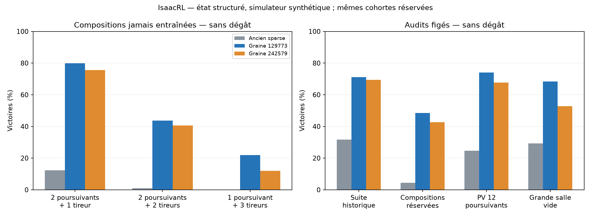

# IsaacRL — apprentissage et généralisation, 8 novembre 2026

**La progression par compétences donne un signal de généralisation mesuré sur deux
apprentissages indépendants depuis des poids neufs.** Les trois compositions réservées
ne sont présentes dans aucun palier d'entraînement. Les checkpoints sont choisis
sur le développement et la rétention ; les audits sont exécutés après gel des poids.

## Résultats des audits figés

Pour chaque budget, les anciens et nouveaux modèles jouent les mêmes cohortes.
128 épisodes par cellule ; compositions : 3 familles × 3 PV poursuivants × 128 =
**1 152 épisodes par modèle et budget**. Actions déterministes, même simulateur
natif, même physique et même horizon de 400 décisions. Les deux nouveaux modèles
sont entraînés avec fin au premier dégât ; l'examen 3 PV mesure aussi leur transfert
vers une tolérance aux dégâts.

| Examen | Ancien agent | Graine 129773 | Graine 242579 |
|---|---:|---:|---:|
| Compositions réservées, sans dégât | 4.4 % | 48.5 % | 42.7 % |
| Compositions réservées, 3 PV abstraits | 8.0 % | 80.8 % | 72.2 % |
| Suite historique, sans dégât | 31.6 % | 71.1 % | 69.5 % |
| Poursuivants 12 PV réservés, sans dégât | 24.7 % | 74.1 % | 67.7 % |
| Grande salle vide, sans dégât | 29.2 % | 68.3 % | 52.8 % |

Le budget de trois PV est **abstrait** : un dégât retire un PV, mort au troisième,
donc au plus deux dégâts dans une victoire. Il ne représente pas trois cœurs
calibrés d'Isaac. Les gains comparés à l'ancien agent portent sur le pipeline
complet, avec davantage de transitions ; ce n'est pas une ablation à compute égal.

## Détail des compositions réservées, sans dégât

| Composition jamais entraînée | Ancien | Graine 129773 | Graine 242579 |
|---|---:|---:|---:|
| 2 poursuivants + 1 tireur | 12.2 % | 79.9 % | 75.5 % |
| 2 poursuivants + 2 tireurs | 1.0 % | 43.8 % | 40.6 % |
| 1 poursuivant + 3 tireurs | 0.0 % | 21.9 % | 12.0 % |

Les poursuivants ont 2/4/8 PV et les tireurs 12 PV. Les départs, vitesses et
phases de tir changent avec les graines réservées. Les familles sont pondérées
également. Les autres métriques, timeouts, tirs et dégâts sont dans `comparison.csv`,
`families.csv` et les deux `final-audit-seed*.json`.

## Ce qui a été challengé et ce que les essais montrent

**Le 1v4 unique masque les compétences manquantes.** La recette acquiert d'abord
la visée sans attaques, puis un tireur à PV croissants, deux tireurs, les poursuivants
et enfin les mélanges. Les examens conservent les tâches précédentes. Chaque
promotion exige deux contrôles réussis ; les budgets expirés sans gate restent
des échecs de passage, consignés dans `ITERATIONS.md`.

**Plus de vie ne produit pas automatiquement plus d'évitement.** Ablation depuis
le même parent, 800 updates par bras et même curriculum 2/4/8/12 PV du tireur :

- Graine 129773 : entraînement strict 98.0 % sans dégât ; entraînement 3 PV 94.9 % de clears, dont 20.3 % sans dégât.
- Graine 242579 : entraînement strict 96.5 % sans dégât ; entraînement 3 PV 98.0 % de clears, dont 46.5 % sans dégât.

Les deux objectifs favorisent des compromis différents. Le parcours strict est
retenu pour apprendre l'évitement ; cela ne prouve pas qu'il soit optimal pour
tous les personnages, objets et combats réels.

**Le shaping n'a pas de supériorité générale démontrée.** Le potentiel est
1,5 × (gamma Phi_suivant - Phi_actuel), Phi = fraction des PV ennemis retirés,
annulé à tout terminal. Les tests prouvent son télescopage actualisé sur victoire,
mort et timeout : pas de crédit résiduel pour les dégâts partiels d'une défaite.
Comparaison sur deux tireurs natifs depuis un même parent, exposition égale entre
bras de chaque graine, avec rétention :

- Graine 129773 : sparse 75.0 %, potentiel 74.2 %.
- Graine 242579 : sparse 81.6 %, potentiel 82.8 %.

L'ordre s'inverse entre graines. La suite conserve sparse, choix fixé après la
première graine, sans choisir la reward sur les audits OOD. Le premier run a
436 updates par bras au plafond mural, le second 400 ; les checkpoints retenus
dans les deux cas sont à l'update 400. Une petite différence sur deux graines
ne constitue pas une preuve statistique de supériorité.

**Les quatre poursuivants révèlent l'intérêt du curriculum pondéré.** Le palier
général plafonne près du seuil ; concentrer 50 % des exemples sur cette cohorte
permet de continuer tout en gardant les tireurs. La seconde graine demande une
continuation supplémentaire. Les seuils restent inchangés. Ce résultat souligne
aussi la sensibilité d'une gate à 70 % sur 256 essais : 69,9 % et 70,3 % diffèrent
d'un seul épisode. Une future campagne gagnerait à contrôler la stabilité sur
plusieurs cohortes, plutôt qu'à surinterpréter cette frontière.

## Coût et limites pratiques

- Expériences enregistrées : première graine **20.1 min**, seconde
  **32.5 min**, hors préparation globale et audits finaux.
- Transitions de la lignée des poids retenus : 173,670,400 et
  160,563,200, contre 31 162 368 pour chaque ancien agent. Les expériences
  des autres bras représentent du calcul supplémentaire.
- Les expositions diffèrent entre graines car la progression est adaptative.
  Les prolongations et échecs de gate sont conservés, sans masquer les budgets.
- La suite historique comprend aussi des familles non entraînées dans la nouvelle
  recette ; son score est un indicateur de couverture, pas une suite ID homogène.
- **Quatre tireurs seuls restent un échec important** : Graine 129773 : 1.6 % ; Graine 242579 : 0.0 % sans
  dégât. Les salles à beaucoup de projectiles et les composantes à trois tireurs
  sont les prochains axes ; les bons scores moyens ne les résolvent pas.
- Deux graines donnent un signal prometteur, pas une garantie de robustesse.
- Observations structurées privilégiées ; deux archétypes contrôlés, rectangle
  vide. Aucun boss, objet, obstacle ni jeu Isaac réel validé dans cette campagne.
  La fidélité des mouvements ne certifie pas celle de toutes les IA du jeu.

## Contrôles et livrables

19 tests passent. Tests CPU : récompenses, budget de vie, immunité, vrais terminaux, snapshots,
timeouts finis, reset, permutation des entités. Qualification native/tensorielle
sur GPU pour les deux budgets, avec timeouts forcés. Contrats de collecte/PPO
existants conservés. Sources, SHA des checkpoints, absence des compositions
réservées dans tous les schedules et lignées parentales vérifiés sur CPU.

- `PROTOCOLE.md`, `ITERATIONS.md` : objectifs, critères et décisions avant chaque run.
- `summary.json`, `comparison.csv`, `families.csv`, `ablations-summary.json`.
- `final-audit-seed129773.json`, `final-audit-seed242579.json`, `integrity.json`.
- Meilleurs poids : `mixed-seed129773/life1-sparse-best.pt` et
  `replication-seed242579/mixed/life1-sparse-best.pt`, avec sidecars et artefacts
  W&B strictement hors ligne. Entrée : 238 features + commande précédente/BOS.
- Code : `campaign_core.py`, `run_campaign.py`, `replicate_recipe.py`,
  `audit_suites.py`, `validate_artifacts.py`, sources capturées dans chaque run.

## Visualisation synthétique

[Animation des quatre premiers épisodes](evidence/generalization/replay/replay.gif) et
[trajectoires finales](evidence/generalization/replay/final.png). Composition jamais entraînée
2 poursuivants + 2 tireurs, graine CPU fixée 949001, trois victoires et un échec.
Ces quatre cas ne servent pas à estimer le taux de réussite. Ce ne sont pas des
images du vrai jeu ni les épisodes des audits GPU. Les traces brutes et le SHA
du modèle figurent dans `replay-final/`.

Code et preuves principales committés localement dans IsaacRL ; poids conservés
dans les sorties de campagne et artefacts W&B hors ligne. Aucun push ni déploiement.
