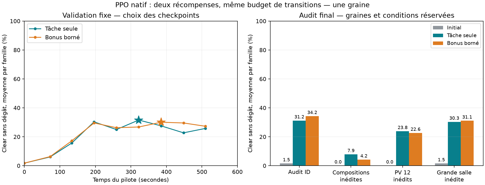

# IsaacRL — pilote de dix minutes : résultats

Le pilote a duré **568.0 s**, soit 9 min 28 s, évaluations initiales, contrôles et audits finaux inclus. Deux PPO ont partagé ce budget, avec **31,162,368 transitions chacun**. Les pré-vols sur copies jetables sont séparés.

## Réponse principale

Un signal net de progression apparaît sur plusieurs familles, mais pas une compétence générale Isaac. Les deux bras satisfont le critère fixé avant le lancement (+5 points de réussite et au moins trois familles en progrès). Les mélanges nouveaux restent beaucoup plus difficiles que les familles entraînées.

| Audit | Initial | Tâche seule | Bonus de dégâts borné |
|---|---:|---:|---:|
| Familles entraînées, autres graines | 1.5 % | 31.2 % | 34.2 % |
| Compositions jamais entraînées | 0.0 % | 7.9 % | 4.2 % |
| Poursuivants à 12 PV, jamais entraînés | 0.0 % | 23.8 % | 22.6 % |
| Grande salle vide, jamais entraînée | 1.5 % | 30.3 % | 31.1 % |

Ces taux sont des moyennes des familles, après moyenne de leurs variantes de PV. Ils ne donnent pas davantage de poids aux familles possédant plus de variantes. L’audit ID et la validation servant au choix des checkpoints ont des graines différentes. Les tests réservés ne choisissent aucun checkpoint.

Les meilleurs checkpoints ont été retenus à la mise à jour 490 pour la tâche seule et 585 pour le bonus, sur 951 mises à jour au total par bras. Les dernières évaluations étaient moins bonnes : prolonger ce même entraînement n’a pas produit une hausse continue.

## Récompenses : ce que le test permet de dire

Le bonus de dégâts atteint au maximum 0,1 par épisode, en fraction des PV initiaux. Il ne domine plus le point de victoire et n’avantage pas les cibles à beaucoup de PV. Les pénalités de mur et les bonus de visée/distance/kill sont absents.

Le bonus gagne environ trois points sur l’audit ID, mais perd sur les compositions réservées et ne dépasse pas la tâche seule sur les PV inédits. **Pas d’avantage global convaincant sur ce pilote à une seule graine.** Il serait incorrect de conclure qu’il améliore ou dégrade universellement l’apprentissage.

Le critère de réussite reste « vider la salle sans subir de dégât ». Une mort au premier contact et un timeout sont distincts. Cet objectif est plus strict que la survie avec une réserve de PV dans le vrai jeu ; il peut favoriser l’évitement au détriment de l’efficacité offensive. Les timeouts atteignent encore environ 21–24 % sur l’audit ID final.

## Scénarios : progrès réel, trous importants

| Famille entraînée | Tâche seule | Bonus borné |
|---|---:|---:|
| 1P_0T | 90.3 % | 98.6 % |
| 0P_1T | 20.8 % | 33.3 % |
| 2P_0T | 80.6 % | 84.7 % |
| 1P_1T | 22.2 % | 23.6 % |
| 0P_2T | 0.0 % | 0.0 % |
| 3P_0T | 62.5 % | 73.6 % |
| 1P_2T | 0.0 % | 0.0 % |
| 0P_3T | 0.0 % | 0.0 % |
| 4P_0T | 56.9 % | 56.9 % |
| 3P_1T | 9.7 % | 5.6 % |
| 0P_4T | 0.0 % | 0.0 % |

`P` = poursuivant, `T` = tireur. Les réussites ne viennent pas uniquement du 1v1, mais les salles à plusieurs tireurs restent des trous majeurs : 0 % contre deux, trois ou quatre tireurs seuls. Le 4v1 fixe aurait donc masqué les autres apprentissages, tout en restant un échec réel à corriger.

| Composition réservée | Tâche seule | Bonus borné |
|---|---:|---:|
| 2P_1T | 18.1 % | 11.1 % |
| 2P_2T | 5.6 % | 1.4 % |
| 1P_3T | 0.0 % | 0.0 % |

Le mélange d’entraînement couvre 25 cellules, 11 familles et 1 à 4 ennemis. Des cas de poursuivants à 2 PV donnent des réussites précoces ; ce n’est pas une reproduction à difficulté égale de l’ancien 4v1 à douze impacts. Le choix de poids neufs évite aussi que des familles dites réservées aient déjà été vues par un ancien checkpoint.

La variation de géométrie porte sur une salle rectangulaire vide plus grande, pas sur des obstacles, pièges ou layouts natifs. Les observations sont instrumentées (positions, vitesses, PV, signal de tir), avec commande précédente explicite ; ce n’est pas un agent visuel.

## Boucle complète : le gain réel de vitesse

Comparaison sur copies jetables identiques : 1 024 salles, 32 décisions par collecte, deux époques PPO, trois mesures après chauffe. Les agents sauvegardés ne sont pas modifiés par ce diagnostic.

| Backend | Collecte + PPO par update | Transitions/s |
|---|---:|---:|
| Référence tensorielle initiale | 2.0751 s | 15,791 |
| Graphe de la première passe | 0.3404 s | 96,267 |
| Noyaux natifs fusionnés | 0.2902 s | 112,920 |

Le gain est **×7.15 contre la référence initiale**, mais seulement **×1.17 contre le graphe précédent** sur la boucle complète de ce diagnostic. Le dernier ×7 mesuré sur la simulation seule ne se multiplie pas par ×7 sur tout le training.

La collecte inclut maintenant surtout l’inférence, les observations et la gestion du rollout. Les gradients prennent un temps comparable à cette collecte. Le moteur physique n’est donc plus le frein dominant. Ces mesures courtes ont leurs échantillons bruts dans `training-backends.json`.

## Vérifications et provenance

- Cinq tests de contrats passent : séparation des scénarios, équilibrage des familles, récompense bornée, bootstrap terminal/timeout et commande précédente.
- Le wrapper natif de training avec auto-reset et observation terminale passe la comparaison GPU avec la référence, avec RNG identique. Écart maximal au pré-vol : 5,96e-8.
- GAE coupe les épisodes et bootstrappe les timeouts sur la vraie dernière observation, jamais sur l’observation du reset.
- Une graine d’apprentissage, évaluations modestes : ce sont des signaux de pilote, pas une supériorité statistique d’un reward.
- Aucun entraînement dans le vrai Isaac, aucun ancien checkpoint remplacé, aucun envoi W&B en ligne. Les checkpoints et optimiseurs ont des métadonnées et références d’artefacts W&B hors ligne.

## Décision proposée

Le pipeline apprend maintenant assez vite pour diagnostiquer les choix. Le prochain blocage est l’efficacité offensive face à plusieurs tireurs et le transfert aux nouveaux mélanges. Avant d’allonger le même run, isoler ce blocage et réexaminer l’objectif sans dégât. Le bonus borné ne justifie pas à lui seul une adoption par défaut.

Le scraping global n’est pas nécessaire pour conclure ce pilote. Une collecte native ciblée sur ces situations sera plus informative qu’une accumulation non vérifiée de toutes les salles et monstres.

Artefacts : `run/report.json` (mesures complètes et sources figées), `summary.json`, `family-results.csv`, `courbes.png`, `training-backends.json` et les quatre checkpoints best/latest dans `run/`.

